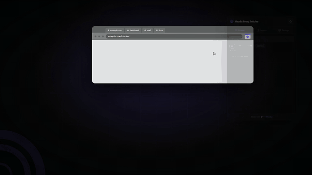

<div align="center">


# Mezdia Proxy Switcher

**Manage and switch proxies in your browser.**

A Manifest V3 extension for Chrome, Edge, Firefox and every other browser whose engine can route
traffic: keep a list of proxies, jump between them in one click, and decide exactly which tabs
should be routed.

[](manifest.json)
[](https://github.com/Mezdia2/proxy-switcher-extension/releases/tag/v5.0.0)
[](#browser-support)
[](#import-format)
[](#languages)
[](#permissions)

<br/>

**Watch the 45-second tour** — [download the 1080p teaser](https://github.com/Mezdia2/proxy-switcher-extension/releases/download/v4.0.2/Mezdia-Proxy-Switcher-Promo-1080p.mp4)

[](https://github.com/Mezdia2/proxy-switcher-extension/releases/latest)

*The popup drops out of the toolbar icon, the active proxy lights up, and everything else waits its turn.*

</div>

---

## Why this exists

Most proxy switchers treat the whole browser as one switch. In practice you rarely want that —
you want one research tab going out through a different exit while your bank tab, your local
dev server and your mail keep their normal connection.

Mezdia Proxy Switcher is built around that difference:

| | |
|---|---|
| **Per-group routing** | Apply the proxy to the whole browser, or only to the tabs inside one tab group. Group mode is the reason this extension exists. |
| **Three protocols** | HTTP, HTTPS and SOCKS5, each with its own badge, so a mixed pool stays readable at a glance. |
| **One-click switching** | The active proxy is marked with a green dot and a left accent bar; click another to move over. |
| **Bulk import** | Paste a whole file at once. Comments, credentials and protocol prefixes are all understood. |
| **Search and filter** | Narrow a long list by text or by protocol before you pick. |
| **Edit and delete** | Fix an entry in place, or remove it and undo the mistake from the toast. |
| **Excluded URLs** | Keep domains out of the tunnel — plain domains or `*.wildcard` patterns, added as tags. |
| **Clean switch** | Optionally reload the current and other tabs, and drop cookies and cache as part of switching. |
| **Dark and light** | A real light theme, revealed with a circle-wave transition that grows out of the corner. |
| **Four languages** | English, Persian, Russian and Arabic — with right-to-left layout that keeps IP addresses and domains readable left-to-right. |

---

## Browser support

One source tree, packaged per engine by [scripts/build.mjs](scripts/build.mjs).

| Browser | Engine | Package | Notes |
|---|---|---|---|
| Chrome, Chromium, Brave, Vivaldi, Arc, Yandex | Blink | `chrome` | Routed with an inline PAC script. |
| Microsoft Edge | Blink | `edge` | Same engine, a separate artifact because each store wants its own upload. |
| Opera | Blink | `chrome` | Chromium, so the Chrome package applies. |
| Firefox desktop 121+ | Gecko | `firefox` | Routed per request through `proxy.onRequest`; see [how routing differs](#how-routing-differs-per-engine). |
| Safari | WebKit | — | Not supported: WebKit extensions have no `proxy` API at all, so no extension can change Safari's proxy. |
| Firefox for Android | Gecko | — | Not supported: `proxy.settings` is refused on Android and extensions run without a proxy control surface. |

---

## Install

### Chrome, Edge and other Chromium browsers

1. `npm install && npm run build`, or just clone the repository.
2. Open `chrome://extensions` (or `edge://extensions`).
3. Turn on **Developer mode** — top right.
4. Click **Load unpacked** and select `dist/chrome` (`dist/edge` for Edge, or the repository root).
5. Pin **Mezdia Proxy Switcher** to your toolbar.

### Firefox

A permanent install needs a listing on addons.mozilla.org. For a local run, Firefox accepts the
built package as a temporary add-on:

1. `npm install && npm run build`.
2. Open `about:debugging#/runtime/this-firefox` and click **Load Temporary Add-on**.
3. Pick `dist/firefox/manifest.json` (or the built `mezdia-proxy-switcher-firefox-vX.Y.Z.xpi`).
   A temporary add-on is dropped when Firefox closes.

Or let the tooling boot a disposable Firefox profile with the extension already installed:

```
npm run run:firefox
```

---

## Quick start

1. Open the popup and go to **Import**.
2. Add one proxy under **Add Proxy**, or paste a whole list under **Bulk Import** and hit **Save**.
3. Back on **Proxies**, click the entry you want. It goes green — you are routed.
4. Want out? Click **Disable Proxy** at the top of the list, or click the active entry again.

Settings such as reloading and cookie cleanup are applied the next time you switch, not when you
press save — the popup says so at the top of that tab.

---

## Import format

Bulk import accepts one proxy per line. The protocol prefix is optional and defaults to HTTP.

```
# Comments start with a hash and are kept in the list as section labels
185.224.128.0:8080
185.224.128.0:8080:login:password
login:password@185.224.128.0:8080

https: 51.15.24.96:443
socks5: 91.243.82.12:1080:login:password
```

| Protocol | Accepted forms |
|---|---|
| **HTTP** | `ip:port` · `ip:port:login:password` · `login:password@ip:port` |
| **HTTPS** | `https: ip:port` · `https: ip:port:login:password` · `https: login:password@ip:port` |
| **SOCKS5** | `socks5: ip:port` · `socks5: ip:port:login:password` · `socks5: login:password@ip:port` |

A comment line placed directly above an entry becomes that entry's label, so a pasted file keeps
its section headings.

---

## Group mode

**Settings → Proxy Scope → Mezdia Group** limits the proxy to the tabs in one tab group.
Everything outside the group connects directly.

1. Open the tabs you want proxied.
2. Select them, right-click, **Add tabs to group**, and name the group exactly **`Mezdia`** — the
   name is case-sensitive. Or press **Create Mezdia Group from Current Tab** in the popup.
3. Watch **Group Status**: it reports whether the group exists, how many tabs it holds, and which
   domains are currently going through the proxy.

Adding or removing tabs, or navigating a grouped tab to a new domain, updates the routing within
about a second — no need to re-apply.

**On Firefox** the same flow works, with one difference: the platform exposes no API for naming a
tab group, so the extension cannot stamp `Mezdia` on it. Press **Create Mezdia Group from Current
Tab** and the group it creates — however it looks in your tab bar — is the group it proxies; tabs
you move into it are picked up the same way. The popup says this in the group status panel.

> **Worth knowing** — routing is decided by domain, not by tab. If the same domain is open both
> inside the Mezdia group and in a normal tab, the proxy applies to every request to that domain.
> For a clean separation, keep different domains in each context.

---

## Settings reference

| Setting | What it does |
|---|---|
| **Proxy Scope** | `All Tabs` routes the whole browser. `Mezdia Group` routes only the group. |
| **Reload current tab** | Reloads the active tab after switching. |
| **Reload all other tabs** | Reloads every other tab too, so cached responses do not linger. |
| **Remove cookies** | Clears cookies as part of the switch. |
| **Remove cache** | Clears the HTTP cache as part of the switch. |
| **Language** | Auto (browser), English, Persian, Russian or Arabic. |
| **Excluded URLs** | Domains that must never use the proxy. Type and press Enter or comma; `*.` patterns are supported; click × to remove. |

---

## Permissions

Every permission is there because the proxy APIs require it — none of them is used for anything
else.

| Permission | Why it is needed |
|---|---|
| `proxy` | Reads and writes the browser's proxy configuration. |
| `webRequest` + `webRequestAuthProvider` | Answers `407 Proxy Authentication Required` for proxies that need a login and password. |
| `browsingData` | The optional "remove cookies / remove cache" switch. |
| `storage` | Saves your proxy list and settings. |
| `tabGroups` | Finds the Mezdia group and the domains inside it. Blink only — the Firefox build drops it, since Gecko has no such API. |
| `tabs` | Firefox only: without it Gecko hides `tab.url`, and group mode needs each tab's URL to know what to route. |
| `<all_urls>` (host) | Both engines require broad host access to intercept proxy authentication challenges, and the per-request policy has to cover every host. |

**On the data side:** your list and settings live in `chrome.storage.local` on your own machine.
The extension ships no analytics, no crash reporting and no remote code — the only network
requests it makes are to the proxies and sites you point it at.

---

## How routing differs per engine

The two engines do not offer the same proxy surface, so `assets/js/sw.js` builds one policy and
hands it to whichever engine it is running in:

| | Blink (Chrome, Edge) | Gecko (Firefox) |
|---|---|---|
| **Where the policy lives** | An inline PAC script written with `proxy.settings.set({mode: "pac_script"})`. | A `proxy.onRequest` listener that answers per request. Gecko has no API for inline PAC — `pacScript.data` does not exist there. |
| **"Connect directly"** | The PAC returns `DIRECT`. | The listener returns `null`, which clears the proxy for that request. (`{type: "direct"}` would not: it falls back to the browser's own configuration.) |
| **Disabled state** | `proxy.settings.clear()`. | The listener is unregistered, so requests fall back to whatever the browser was already doing. |
| **HTTP(S) proxy login** | `webRequest.onAuthRequired` answers the `407` challenge. | Identical — the same listener answers it. A `Proxy-Authorization` header smuggled into the proxy record is ignored by Gecko, measured on the wire. |
| **SOCKS5 login** | `webRequest.onAuthRequired`. | Carried in the proxy record itself (`username`/`password`), and Gecko negotiates SOCKS5 username/password auth with it. |
| **Tab groups** | `tabGroups` finds the group named `Mezdia`. | No `tabGroups` API; `tabs.group` works, so the created group is remembered by id. |
| **`proxy.settings`** | Available. | Refused without private-browsing rights (`proxy.settings requires private browsing permission`), so the Gecko build never calls it. |

`node scripts/check.mjs` runs both engines side by side and asserts they take the same routing
decision for every URL in [scripts/golden/pac-cases.json](scripts/golden/pac-cases.json), which was
recorded from the shipped Blink behaviour — so the Gecko path cannot quietly disagree with what
Chrome already does.

---

## Building for every browser

The repository root *is* the Chromium source of truth. Every other target is a declared transform
of it, in [scripts/targets.mjs](scripts/targets.mjs).

```
npm install
npm run build                 # all targets -> dist/<target>/ + dist/packages/
npm run build -- --target=firefox
npm run check                 # packaging, i18n, archives and cross-engine routing parity
```

Artifacts are deterministic (sorted entries, fixed timestamps, no absolute paths):

```
dist/packages/mezdia-proxy-switcher-chrome-v5.0.0.zip
dist/packages/mezdia-proxy-switcher-edge-v5.0.0.zip
dist/packages/mezdia-proxy-switcher-firefox-v5.0.0.xpi
```

The ZIP writer is [scripts/zip.mjs](scripts/zip.mjs) on top of `node:zlib`, so the build has no
runtime dependencies at all — `web-ext` is a development tool only, used to lint and to boot
Firefox.

**Firefox add-on id.** AMO requires an id in an MV3 manifest, so the build writes
`mezdia-proxy-switcher@mezdia2.github.io` unless told otherwise. Once the add-on is listed, publish
with the real id — it cannot be changed afterwards:

```
GECKO_ADDON_ID=<id-of-your-listing> npm run build
```

## Checks

```
npm run check            # 79 assertions: packages, manifests, archives, locales, engine parity
npm run verify:firefox   # boots dist/firefox in a real Firefox and reads what reached the wire
npm run lint:firefox     # the same validator AMO runs
```

`verify:firefox` copies the built package to a temp directory, appends a harness script to that
copy only, boots Firefox on a throwaway profile with a second proxy as the browser default, and then
asserts: an included host reaches the extension's proxy, an excluded host reaches neither proxy,
disabling restores the browser default, re-enabling routes again, and the popup can still load
locale files while the tunnel is up.

---

## Releasing

[.github/workflows/release.yml](.github/workflows/release.yml) builds and publishes every browser
package for a version tag:

```
npm version 5.0.0 --no-git-tag-version   # keeps package.json and manifest.json in step
node scripts/build.mjs                   # sanity check locally
git commit -am "Release 5.0.0"
git tag v5.0.0
git push origin main v5.0.0
```

The workflow then refuses to publish if `manifest.json` disagrees with the tag, runs the checks and
the real-Firefox verification, and attaches `chrome.zip`, `edge.zip`, `firefox.xpi` and
`SHA256SUMS.txt` to the GitHub Release. It can also be run by hand from the **Run workflow** button
with an existing tag, which re-attaches assets without touching the tag.

[.github/workflows/build.yml](.github/workflows/build.yml) runs the same build, checks, AMO
validation and Firefox verification on every push and pull request, and uploads the packages as
workflow artifacts.

---

## Languages

English, Persian, Russian and Arabic are bundled. Persian and Arabic render right-to-left, while
technical content — IP addresses, ports, domains and proxy lists — is pinned left-to-right so it
stays readable inside an RTL layout.

---

## Repository layout

```
.
├── manifest.json              Manifest V3 (Chromium source of truth), default locale en
├── popup.html                 The toolbar popup
├── options.html               Localized options shell
├── _locales/                  en · fa · ar · ru
├── assets/
│   ├── css/                   popup.css (dark-first tokens) · options.css
│   ├── js/                    sw.js (background) · popup.js · options.js · theme-transition.js
│   └── images/                Toolbar and extension icons
├── scripts/
│   ├── targets.mjs            One transform per engine: what each package is allowed to contain
│   ├── build.mjs              Builds dist/<target>/ and dist/packages/
│   ├── check.mjs              Packaging, i18n, archive and cross-engine routing parity
│   ├── harness.mjs            Runs sw.js against a fake Blink or Gecko runtime
│   ├── zip.mjs                Deterministic ZIP writer on node:zlib
│   └── verify-firefox.mjs     Boots dist/firefox in a real Firefox and reads the wire
├── .github/workflows/         build.yml (every push/PR) · release.yml (per-browser release assets)
└── dist/                      Generated: unpacked copies + signed-ready packages (gitignored)
```

`assets/js/sw.js` owns the proxy configuration and group routing, and picks its engine by
capability; `popup.js` is the UI and `theme-transition.js` wraps the View Transition API used for
the theme change, with a fallback for browsers that lack it.

---

## Release notes

The full changelog lives on the [releases page](https://github.com/Mezdia2/proxy-switcher-extension/releases).

**5.0.0 — Firefox, and a package per browser.** The same extension now ships for Gecko: a
per-request proxy policy replaces the inline PAC script that only Blink can store, HTTP proxy
logins keep flowing through the same `407` handler, and tab groups fall back to the group the
extension creates because Firefox cannot name one. `npm run build` produces the Chrome, Edge and
Firefox packages from one source tree, `npm run check` proves the two engines make identical routing
decisions, and the release workflow attaches every package to the GitHub Release.

Highlights from the 4.x line: SOCKS5 support, protocol badges, search and filter, inline edit and
delete with undo, tag-style excluded URLs, per-group routing with live status, and the circle-wave
theme transition.

---

## Credits

Built with care by [Mezdia](https://github.com/Mezdia).

<div align="center">

 **Switch smarter. Route anywhere.**

</div>
